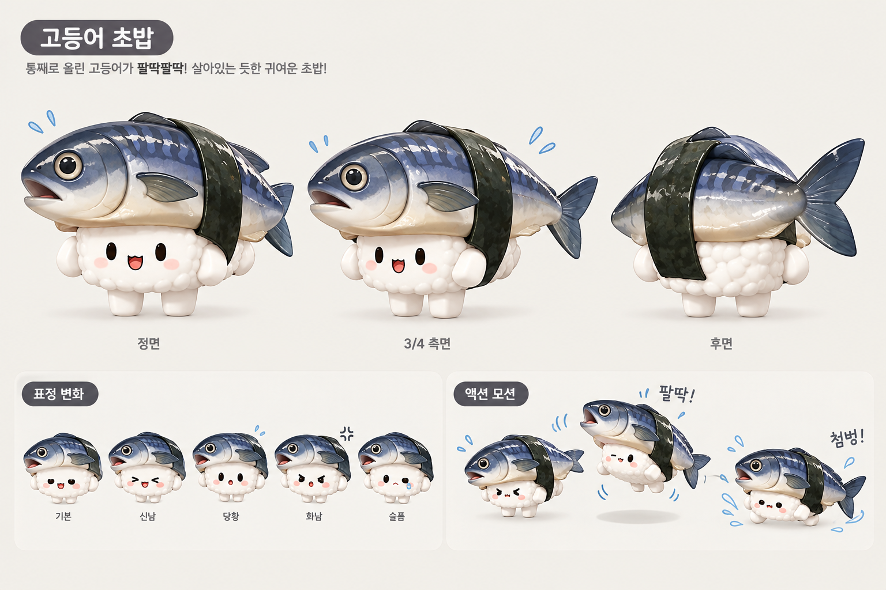

# 아트 디렉션 — 스시런 (스팀판)

> 사용자 기준 (2026-11-16): "지금처럼 개밤티처럼 만들면 안 됨. 꽤 높은 퀄리티여야 해. GPT가 만들어 준 스킨 이미지와 유사한 퀄리티는 돼야 함. 캐릭터도 쫀득쫀득한 모션을 가져야 하고."
>
> **이 문서의 모든 결정은 "콘셉트 시트와 나란히 놓았을 때 같은 게임처럼 보이는가"로 판단한다.**

## 1. 목표 품질 — 콘셉트 시트

| 시트 | 파일 |
|---|---|
| 고등어 초밥 (정면·3/4·후면·표정 5종·액션 모션) | [`reference/concept-mackerel.png`](reference/concept-mackerel.png) |
| 우니 군함·장어 초밥 (정면·3/4·후면) | [`reference/concept-uni-eel.png`](reference/concept-uni-eel.png) |
| 드래곤·용 스시 공격 | [`reference/concept-dragon-attack.png`](reference/concept-dragon-attack.png) |
| 스킨 뽑기 UI | [`reference/concept-draw-ui.png`](reference/concept-draw-ui.png) |
| 맵 6종 | [`reference/concept-maps.png`](reference/concept-maps.png) |

### 시트에서 읽은 "품질의 정체" (이걸 빠뜨리면 싸 보인다)
1. **디자이너 토이 비율** — 몸(밥)이 크고 네모나게 둥근 덩어리, 팔다리는 짧고 통통, 얼굴은 밥 앞면 아래쪽 2/3 지점.
2. **재질이 셋 이상 겹친다** — 밥(무광 + 알갱이 요철), 토핑(촉촉한 광택, 빛이 살짝 비치는 느낌), 김(어두운 녹색, 결 텍스처 + 약한 광택). 로블록스판은 단색 파츠라 이게 없었다.
3. **밥알 요철** — 매끈한 덩어리가 아니라 둥근 알갱이가 겹친 표면 (노멀맵 + 약간의 실제 굴곡).
4. **부드러운 스튜디오 조명** — 큰 면광원 같은 부드러운 그림자, 모서리 하이라이트, 접지 그림자(AO). 강한 단색 그림자 금지.
5. **얼굴** — 크고 반짝이는 검은 눈(흰 하이라이트 1~2개), 볼터치(분홍 번짐), 작은 입. 표정 교체(기본·신남·당황·화남·슬픔·아픔).
6. **모션이 포즈로 읽힌다** — "팔딱!", "첨벙!"처럼 액션이 과장된 실루엣(늘어남·기울어짐·토핑이 휨).

## 2. 왜 로블록스판은 싸 보였나 (반복하지 않기)
| 원인 | 스팀판 대책 |
|---|---|
| 기본 도형(파츠) 조립 | 정식 3D 모델 (조각 → 리토폴로지 → UV → 텍스처) |
| 텍스처·노멀맵 없음 | PBR 텍스처 세트(색·노멀·거칠기·AO) + 밥알 노멀 |
| 평평한 조명 | URP + 후처리(톤매핑·SSAO·블룸 약하게) + 3점 조명 규칙(4절) |
| 굳은 몸 | 절차적 쫀득 모션(이미 구현) + 손으로 만든 키 애니메이션 + 토핑 2차 움직임(5절) |
| 표정 없음 | 얼굴 텍스처 아틀라스 6종 교체 |

## 3. 캐릭터 제작 파이프라인

### 3.1 구조 — "몸 하나 + 토핑 교체"
- **기준 몸 1개**(밥 몸통 + 팔다리 + 얼굴)를 최고 품질로 만들고, **스킨은 토핑·김·소품만 바꾼다.** 몸·히트박스가 모두 같아야 한다는 원칙(스킨은 겉모습만)과 비용 절감을 동시에 만족.
- 예외 스킨(드래곤·제트기처럼 실루엣이 크게 다른 전설)은 같은 뼈대(리그)에 추가 파츠를 붙인다.

### 3.2 만드는 방법 (권장 순서)
1. **콘셉트** — 지금처럼 GPT로 정면·3/4·후면 + 표정 시트를 만든다. 새 스킨도 같은 프롬프트 틀(같은 조명·배경·비율)로.
2. **3D 초안: AI 이미지→3D 생성 도구**(예: Tripo, Meshy, Rodin 계열 — 도구가 빨리 바뀌므로 3단계 전에 2~3개로 같은 시트를 넣어 비교)
   - 장점: 콘셉트 시트와 거의 같은 형태가 몇 분 안에 나온다.
   - 한계: 메시가 지저분하고(삼각형 덩어리), 파츠가 붙어 있고, 텍스처 해상도·일관성이 들쭉날쭉 → **그대로 게임에 넣지 않는다.**
3. **다듬기 (Blender, 무료)** — 리토폴로지(게임용 깔끔한 메시, 캐릭터당 대략 1만~2만 삼각형), 파츠 분리(몸·토핑·김·팔·다리), UV, 텍스처 베이크, 얼굴은 별도 아틀라스.
   - 직접 하기 어렵다면 **이 단계만 외주**(스타일라이즈드 캐릭터 모델러)로 맡기는 게 가성비가 가장 좋다. 견적은 3단계 시작 전에 2~3곳 받아 기준 몸 1개로 테스트.
4. **리그(뼈대)** — 몸·팔·다리·토핑 뼈 + 토핑 2차 움직임용 뼈 사슬(생선 꼬리 등). 휴머노이드가 아니라 **전용 리그**.
5. **애니메이션** — 5절.
6. **Unity 반입 규칙** — FBX, 1 unit = 1 m, 앞 = +Z, 발바닥 = 원점, 텍스처 2048(기준 몸)·1024(토핑). 큰 파일은 Git LFS(`.gitattributes`).

### 3.3 "에셋 스토어"란
Unity 공식 장터 [assetstore.unity.com](https://assetstore.unity.com)에서 남이 만든 3D 모델·애니메이션·셰이더·이펙트·소리·편집 도구를 사서(일부 무료) 프로젝트에 넣는 것. **우리 캐릭터·토핑은 고유 디자인이라 직접 만들고**, 에셋 스토어는 보조에만 쓴다:
- 툰/스타일라이즈드 셰이더, 파티클 이펙트 팩, 주방 소품(그릇·젓가락·냄비 — 다듬어서), 스프링 본(2차 움직임) 도구, UI 효과.
- 라이선스: 상업 게임에 쓸 수 있는 표준 라이선스인지 확인하고 `docs/ASSET-LICENSES.md`에 기록한다.

## 4. 렌더·조명 규칙 (URP)
- **톤매핑** Neutral 또는 ACES, **SSAO** 켬(접지감), **블룸** 약하게(광택 하이라이트만), 색수차·비네트는 약하게만.
- **3점 조명**: 따뜻한 키라이트(부드러운 그림자) + 하늘색 필(어두운 면이 검게 죽지 않게) + 림라이트(실루엣 분리). 맵마다 분위기는 바꾸되 캐릭터가 항상 읽히게.
- **셰이더**
  - 밥: Lit, 거칠기 높음, 밥알 노멀맵 + 가장자리 살짝 밝게(wrap lighting).
  - 토핑: 광택 + **가짜 표면하산란**(빛 반대편 가장자리가 살짝 밝고 따뜻해짐) + 클리어코트 같은 날카로운 하이라이트 — 생선·연어·계란이 "촉촉해" 보이는 핵심.
  - 김: 어두운 녹색 + 결 노멀 + 약한 광택.
  - 눈: 강한 하이라이트 고정(텍스처) — 어떤 조명에서도 반짝.
- **카메라**: 망원 쪽(시야각 45~55°)이 토이 느낌을 살린다.

## 5. 모션 — "쫀득쫀득"
세 층을 겹친다. 하나만으로는 안 된다.

| 층 | 무엇 | 상태 |
|---|---|---|
| ① 절차적 몸 모션 | 스쿼시·스트레치(부피 보존), 착지 눌림 → 지나쳐 늘어남 → 출렁 멈춤, 출발·정지 기울기, 토핑 뒤처짐, 숨쉬기, 걸음 통통 | **구현됨** — `Core/Motion/JellyMotion.cs` (테스트 9개), 인스펙터·실행 중 슬라이더로 튜닝 |
| ② 키 애니메이션 | 달리기 사이클(짧은 팔다리 빠르게), 점프 준비(살짝 웅크림)·공중·착지, 다이브(몸 쭉), 넘어짐·일어나기, 공격, 승리·탈락 포즈, 대기 장난 | 3단계 (기준 몸 리그 후) |
| ③ 2차 움직임 | 토핑·꼬리·김 끝의 스프링 본(팔딱·출렁), 눈 깜빡임, 표정 교체 | 3단계 |

**애니메이션 원칙 체크리스트** (모든 동작에): 예비 동작(anticipation) · 스쿼시/스트레치 · 따라오기·겹치기(follow-through/overlap) · 타이밍 대비(빠르게 튀고 천천히 멈춤) · 과장된 실루엣 · 착지 먼지·작은 효과음.

**조작감 숫자 기준** (1단계에서 확정): 착지 눌림 최소 0.75~0.85배, 출렁임 2~3번 안에 멈춤(약 0.6~0.9초), 달리기 시작 기울기 8~14°, 토핑 지연이 눈에 보이되 어지럽지 않게.

## 6. 품질 관문 (3단계 끝)
1. 같은 각도·조명으로 **게임 화면 vs 콘셉트 시트 나란히** 캡처 — 사용자가 "같은 게임"이라고 느끼는지.
2. 1080p·스팀덱(800p)에서 캐릭터가 작게 보여도 얼굴·토핑이 읽히는지.
3. 40명이 한 화면에 있어도 60fps(목표 PC 사양은 3단계에서 정함).
4. 표정 6종·동작 8종 이상이 모두 "쫀득" 체크리스트를 통과.
