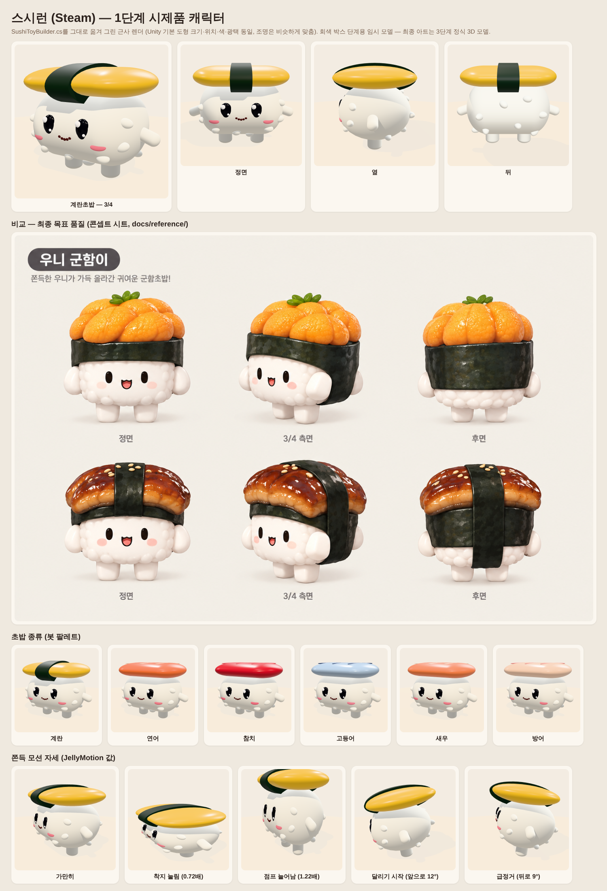

status: in-dev
<!-- draft | ready | in-dev | in-review(사용자 에디터 확인) | done -->

# s1-01 — 조작감 시제품 (혼자, 회색 박스)

- 단계: 1단계 ([`PLAN.md`](../PLAN.md))
- 목적: **그래픽 없이 회색 박스만으로도 "부딪히고 넘어지는 게 웃기고, 캐릭터가 쫀득쫀득한가"**를 확인한다. 아니면 2단계(네트워크)로 가지 않는다.
- 아트 기준: [`ART-DIRECTION.md`](../ART-DIRECTION.md) 5절(모션). 이 단계의 캐릭터 모양은 임시(기본 도형)지만 **움직임은 최종 품질 기준으로 튜닝**한다.

## 범위
| 항목 | 내용 |
|---|---|
| 캐릭터 | Rigidbody 컨트롤러: 달리기·점프(코요테 타임·점프 버퍼)·다이브 → 엎드림 → 일어나기·맞아서 넘어짐. 판정 규칙은 순수 `Core/Movement/MoveLogic` |
| 쫀득 모션 | `Core/Motion/JellyMotion` → `Runtime/Player/JellyBody`: 스쿼시·스트레치(부피 보존), 착지 출렁임, 기울기, 토핑 뒤처짐, 숨쉬기, 걸음 통통. 히트박스는 그대로 |
| 공격 | "모두의 공격" 로컬 버전: 반지름 2.8 m, 튕김 + 1초 넘어짐, 쿨다운 8초, 면역 2초 (`Core/Combat/AttackLogic`, 로블록스판과 같은 규칙) |
| 맵 | 회색 박스 2개 — **회전 벨트(Race)**: 돌아가는 접시·벨트, 휘두르는 젓가락, 체크포인트, 떨어지면 3초 뒤 부활, 결승선 / **회전 꼬치 쇼다운(Final)**: 둥근 접시 위 회전 꼬치 2개, 점점 빨라짐 |
| 봇 | 4~6명이 길을 따라 달리고 가끔 다이브·공격 — 부딪힐 상대 |
| 카메라 | 3인칭 궤도, 스프링 추적, 벽 뚫지 않기, 다이브 시야각 킥, 큰 착지 흔들림 |
| 튜닝 | 실행 중 슬라이더(쫀득 주요 값·달리기·점프·다이브) + `TuningProfile` 에셋으로 저장 |
| 하지 않음 | 네트워크, 잡기(2단계 — 상대가 사람일 때 의미), 최종 아트, 사운드, 메뉴 |

## 수용 기준
- AC1 순수 로직 테스트 `dotnet test` 통과 (라운드 규칙이 로블록스판과 같은 답 — 4~40명 전부, 쫀득 모션 부피 보존·착지 눌림→지나침→멈춤·프레임레이트 무관, 이동 코요테·버퍼·다이브·넘어짐, 공격 대상·튕김·쿨다운). **Claude가 클라우드에서 확인.**
- AC2 사용자 PC에서 프로젝트가 오류 없이 열리고 `SushiRun → Create Feel Prototype Scene` → Play가 된다 ([`SETUP.md`](../SETUP.md)).
- AC3 (사용자) **쫀득 체크** — 아래 "에디터에서 볼 것"을 해 보고 `docs/playtest/s1-feel.md`에 느낌을 적거나 Claude에게 말로 전달.
- AC4 회전 벨트(약 125 m, 체크포인트 3개)를 봇과 같이 끝까지 달릴 수 있고, 떨어지면 3초 뒤 체크포인트에서 부활. 목표 40~60초 — 개발 추정은 깔끔하게 달리면 30~40초라 실측 후 코스 길이·장애물을 맞춘다.
- AC5 회전 꼬치에서 점프·다이브로 피하고, 맞으면 튕겨 나가 넘어진다.
- AC6 60fps 이상(보통 PC, 봇 6명).

## 에디터에서 볼 것 (사용자)
1. **착지**: 높은 곳에서 떨어지면 몸이 눌렸다가(옆으로 퍼짐) 위로 늘어났다가 2~3번 출렁이고 멈추는가? 너무 젤리 같거나 너무 딱딱하면 튜닝 패널에서 `SquashDamping`(낮을수록 출렁), `LandKickPerSpeed`(눌림 세기)를 바꿔 보고 좋은 값을 알려 주세요.
2. **출발·정지**: 달리기 시작하면 앞으로 숙이며 튀어나가고, 급정거하면 뒤로 젖혀졌다 앞으로 출렁하는가? 토핑이 몸보다 살짝 늦게 따라오는가?
3. **점프·다이브**: 점프할 때 몸이 쭉 늘어나는가? 다이브가 "몸을 날리는" 느낌인가, 엎드렸다 일어나는 게 답답하지 않은가?
4. **부딪힘·공격**: 봇을 F로 날리면 웃긴가? 맞은 봇이 넘어졌다 일어나는 게 보기 좋은가?
5. **조작**: 방향 전환이 미끄럽거나 둔하지 않은가? 점프가 너무 높거나 낮지 않은가?
6. **관문 질문**: "그래픽이 회색 박스인데도 한 판 더 하고 싶은가?" — 예/아니요 + 이유.

## 개발 메모
- 임시 캐릭터 모습(Unity 없이 근사 렌더):  — 다시 찍기: `tools/character-preview/shot.js` (SushiToyBuilder를 바꾸면 index.html도 같이).
- 런타임 구조·처음 열 때 주의점: [`docs/dev-notes/s1-runtime.md`](../dev-notes/s1-runtime.md).
- 순수 로직: `Assets/SushiRun/Core/` (UnityEngine 참조 없음) + `tests/SushiRun.Core.Tests` (xUnit, net8.0, LangVersion 9).
- 런타임: `Assets/SushiRun/Runtime/` (Player·Camera·Level·Bots·Bootstrap), 에디터 메뉴: `Assets/SushiRun/Editor/`. 씬은 코드로 만든다(YAML 손으로 안 씀).
- 단위: 미터. 로블록스 수치는 1 stud ≈ 0.28 m로 옮긴 뒤 이 단계에서 다시 맞춘다.
